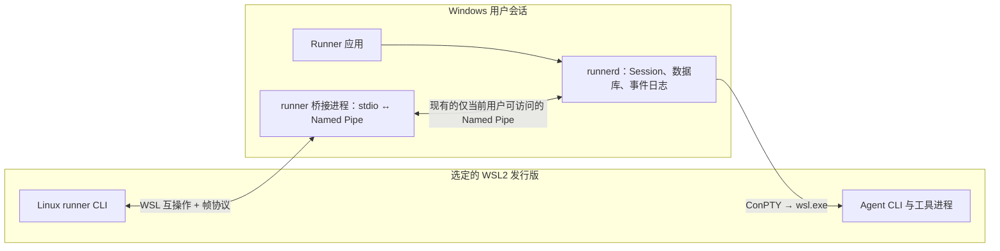

# 988 — Windows Runner 运行 WSL2 Agent

> 跟踪 Issue：[#988](https://github.com/yicheng47/runner/issues/988)。优先级和排期以 Issue 为准。
> 状态：实现中，2026-10-28。实现方案见 [实施计划](../impls/988-wsl2-agent-execution.md)；按用户要求先实现，Windows + WSL2 现场验证由用户在对应机器执行。
> 平台：Windows Runner + WSL2。Runner 应用、守护进程、数据库和权威 mission 日志仍运行及保存在 Windows。这与 [#823](https://github.com/yicheng47/runner/issues/823) 在 Linux/WSL 内运行整套 Runner 的目标不同。

## 目标

用户在 Windows 安装 Runner，在 WSL2 发行版中保留仓库和 Agent CLI。用户可从 Windows 应用选择发行版启动普通 Chat 或 Mission；Agent 使用该发行版内的用户目录、工具和工作目录。会话停止、恢复、Fork，或应用重启后重新连接时，都保持原执行目标。

在该发行版的**普通终端**中，`runner` 也是连接同一个 Windows Runner 的完整 CLI。`runner status`、Role/Crew 管理、`runner mission start --cwd .`、`runner mission feed --follow`，以及 Mission 内的 `runner msg`、`runner signal`、`runner ask` 都可使用。安装 Linux CLI 不得暗中启动第二个 Linux `runnerd` 或创建第二份数据库。

这个使用方式可参考 Docker Desktop 的[按发行版启用 WSL 集成](https://docs.docker.com/desktop/features/wsl/)：Linux 终端中的命令访问同一个后台服务。Cursor 的 `cursor .` 可参考其启动体验，但 Runner CLI 还要读取本地文件、启动任务、持续输出 Feed 和写入 Mission 事件，不能只提供一个打开应用的脚本。

## 首版范围与决定

| 领域 | 决定 |
| --- | --- |
| WSL 版本 | **只支持 WSL2**。发现 WSL1 时给出明确的不支持提示和升级指引。 |
| Windows 宿主 | 原生 Windows `Runner`、`runnerd`、SQLite、事件日志和现有 Named Pipe 继续作为唯一权威状态。 |
| Agent 进程 | Windows `runnerd` 管理 ConPTY，通过所选发行版启动 Agent CLI；Agent 及其工具进程在 WSL2 内运行。 |
| 执行目标 | Role 可提供默认值，启动 Chat/Mission 时可覆盖。每个 Session 固化最终使用的发行版和 Linux 用户，后续修改 Role 不改变旧会话。 |
| Mission 目标 | 首版一个 Mission 的全部 Slot 使用同一执行目标，之后动态加入的 Slot 也继承它；Mission 的选择优先于 Role 默认值。暂不支持一个 Mission 混用 Windows 和 WSL Slot。 |
| WSL CLI | 向每个启用的“发行版 + 用户”安装版本匹配的 Linux `runner`。它连接 Windows `runnerd`，不管理 Linux 守护进程。 |
| 路径 | 工作目录带执行目标身份；Linux 路径在 Linux 解释，Windows 路径在 Windows 解释，只在明确的系统边界转换。 |

Settings 显示检测到的 WSL2 发行版与用户，由用户显式启用集成。现有 Windows 原生 Role 和 Session 行为不变；不能仅凭目录看起来像 `\\wsl$` 就自动切换执行目标。

## 架构

### 启动与生命周期

在有效启动定义和 `SpawnSpec` 中加入执行目标。Runtime Adapter 准备好 Agent 命令后，Windows PTY 层通过 `wsl.exe -d <distro> -u <user> --cd <Linux cwd> --exec <launcher> ...` 启动。Linux 侧轻量 Launcher 设置环境并执行 Agent，不把用户参数拼进 Shell 命令字符串。Agent 是否存在及其 `PATH` 在发行版内判断，不使用 Windows `PATH`、`%USERPROFILE%` 或原生 `.cmd` 探测结果。

启动握手应在 Session 标记为运行前返回发行版、用户、Linux PID/进程组、实际工作目录或具体错误。停止和重启要作用于该 Agent 的 Linux 进程组及其工具子进程。不能假定结束 Windows 侧 `wsl.exe` 就会结束 Linux 子进程，也不能为停止单个 Session 而关闭整个发行版。发行版停止时，新建或恢复 Session 可尝试启动它；失败则保留 Session 并显示原因。现有 Windows Daemon 的恢复和重连规则仍是权威。

### Linux CLI 与 Windows 桥接

Windows 发布包携带 Linux x86_64 版 CLI。启用某个发行版的集成时，将其原子安装到对应用户的 `~/.local/bin/runner`；检测同名非 Runner 命令，不能覆盖。普通终端和 Runner Mission Session 使用同一命令。若 `~/.local/bin` 不在 `PATH` 中，设置页与文档给出处理方式。安装、升级和移除只修改 Runner 管理的文件，开发版与正式版相互隔离。

Linux CLI 在 Linux 侧解析参数、读取文件和标准输入、解析相对路径并格式化输出。它通过 WSL 互操作启动受限的 Windows `runner.exe` 桥接模式。桥接进程通过标准输入/输出转发现有客户端帧协议，再连接 Windows Named Pipe；`runner mission feed --follow` 等订阅也经过这条连接。请求顺序、取消、EOF、错误和退出码必须保持一致。普通 CLI 命令在 Windows 上原本会启动未运行的 Daemon 时，桥接仍保持这一行为，但绝不启动 Linux Daemon。桥接只是传输入口，不是第二个 Daemon，也不开放新的公共 TCP 端口。

当前 CLI 的部分 Mission 命令直接读写 Windows 上的 NDJSON 日志，包括 `msg`、`signal` 和 `ask`（[当前实现](../../crates/runner-cli/src/msg.rs)）。这些操作应通过一组明确类型的桥接操作在 Windows 侧执行，继续使用唯一的权威日志；尽可能保留现有“Daemon 暂时不可用时，Mission 本地命令仍可使用”的语义。不要在 WSL 建第二份日志，也不要依赖 Linux 与 Windows 进程通过 `/mnt/c` 共享文件锁。WSL Session 的 Slot Shim 只提供 Mission 身份，不再把 Windows 可执行文件路径写入 Linux Shim（[当前 Shim](../../crates/runner-daemon/src/cli_install.rs)）。

Linux CLI、Windows 桥接与 Daemon 必须校验协议兼容性。Windows Runner 更新后，刷新已启用发行版内的 Linux CLI；旧版 CLI 应明确提示更新，而不是连接到不兼容 Daemon。桥接沿用 Windows Named Pipe 的用户权限边界，只接受约定的 Runner 协议，不能成为任意 Windows 命令执行入口。

### 路径、文件与身份

WSL 工作目录由执行目标与 Linux 绝对路径共同表示，例如 `{distro: "Ubuntu", user: "me", path: "/home/me/repo"}`；Windows 工作目录保留原生形式。Session 持久化最终目标和目录，Role 后续变化不影响它。首版 Mission 的目标和目录适用于所有 Slot。Project 也需要带目标身份，避免把两个发行版中同名的 `/home/me/repo` 视为同一项目。

`--goal-file` 等文件参数由 Linux CLI 在 Linux 侧读取，`--cwd .` 也先在 Linux 侧解析，再向 Daemon 发送明确的目标和绝对路径。Windows 应用需要打开 WSL 文件时，可在 UI 边界转换为 `\\wsl.localhost\<distro>\...`；Agent 始终收到原 Linux 路径。Windows 磁盘中的目录通过 `wslpath` 或等效的受检转换处理，不假设所有盘符都挂载在 `/mnt/<letter>`。路径需覆盖空格、中文、符号链接和 Linux 大小写敏感名称。

读取 Agent 文件的 Runtime Adapter 要使用该 Session 对应的 Linux Home 和工作目录，包括会话存在性检查、恢复键、Transcript/状态读取、项目信任、账号检测及 Hook。不能用 `%USERPROFILE%` 推断 WSL Agent 的状态。Agent 发出的 Hook 通过 Linux `runner` 与桥接返回 Windows Daemon。启动时生成的系统提示文件等，也必须遵守同一套路径规则。

## 用户流程

1. Settings 列出 WSL2 发行版、默认用户和发行版内找到的 Agent CLI。用户选择发行版并启用集成；Runner 安装或检查 Linux CLI，并执行 `runner status` 连通性检查。同名命令冲突时提示用户，不覆盖已有文件。
2. Role 可默认使用 Windows 原生环境或某个已启用的 WSL2 发行版。Start Chat 和 Start Mission 在工作目录旁显示最终执行目标；首版 Mission 的目标作用于全部 Slot。
3. 启动 Session 时显示发行版和 Linux 工作目录。发行版不存在、Agent CLI 缺失、目录不可访问、WSL 互操作被禁用、CLI/Daemon 版本不兼容，各自给出可处理的错误。
4. 用户在已启用发行版的普通终端中执行 `runner`，操作同一 Windows Runner；Mission 内的 Slot 自动获得自己的 Mission 身份。

## 交付与验证

| 阶段 | 内容 | 进入下一阶段前的证据 |
| --- | --- | --- |
| 0. 技术验证 | 在 Windows + WSL2 机器上验证 ConPTY → `wsl.exe`、进程树停止、stdio 帧转发、Feed 持续输出和跨系统路径。 | 正常退出、强制停止、WSL 关闭、中文目录、标准输入和取消操作有可重复的结果；失败时先修订本方案。 |
| 1. 核心 | 目标化路径与持久化；WSL 启动、检测、停止、恢复和重连。 | Windows 原生 Session 不受影响；WSL Chat 使用正确 Home/CWD，停止后无遗留工具进程。 |
| 2. CLI | 打包和安装 Linux CLI；桥接 Daemon 请求与 Mission 日志操作；版本校验。 | 下述命令在普通 WSL 终端和 Runner Mission Slot 中都通过。 |
| 3. 产品 | Settings 与启动 UI、状态 Hook 和 Transcript、错误状态、用户指南。 | Windows 开发版应用与 WSL2 发行版的选定现场检查通过。 |

自动化检查覆盖执行目标持久化、路径规范化、参数/环境透传、桥接帧与断线、版本不匹配、Mission 日志归属。WSL2 现场检查至少包括：

- 在 `/home/<user>/repo` 和 Windows 磁盘挂载的仓库中执行 `runner status`、Role/Crew 命令、`runner mission start --cwd . --goal-file -`、`runner chat start`。
- `runner mission feed --follow --json` 能及时收到新事件；Slot 内的 `runner msg post/read`、`runner signal`、`runner ask` 正常。
- 带空格、中文和符号链接的路径；桥接前后的标准输入、输出、错误输出与退出码一致。
- Chat/Mission 停止、恢复、Fork、应用关闭重开、Windows Daemon 重启、WSL 发行版停启，以及 Windows Runner 更新后 WSL CLI 的版本同步。
- 没有第二个 Daemon/数据库、重复 Mission 事件或遗留 Linux 进程；Windows 原生行为只检查受共享代码修改直接影响的路径。

需要更新的用户指南是[安装](../guide/getting-started/install.md)和[支持的 Agent](../guide/reference/supported-agents.md)。新增 CLI 安装或目标命令确定后，同步 CLI Help 与生成的命令参考。另同步角色、Chat、Mission 和 Project 的用户指南。实现记录和未执行的现场检查见 [验证记录](../tests/988-wsl2-agent-execution.md)。本机自动化通过不代表 Windows + WSL2 现场验证通过。

## 现场验证重点

- 现有客户端传输能否直接复用帧读写器连接 stdio，还是需要小范围抽象；尽量保持现有 Wire 格式与版本握手。
- 当 Windows 侧 `wsl.exe` 先退出时，怎样可靠定位并结束对应的 Linux 进程组，同时不影响发行版内其他进程。
- Runtime Adapter 的哪些文件读取可通过受检的 WSL UNC 路径在 Windows 完成，哪些必须交给 Linux 侧 Helper；尤其测量 Transcript 与状态 Hook 的正确性和延迟。
- 同一发行版中的多个用户、被策略禁用的 WSL 互操作，以及现有非 Runner `runner` 命令该如何处理。

## 相关资料

- [#278](https://github.com/yicheng47/runner/issues/278) 与 [PR #252](https://github.com/yicheng47/runner/pull/252)：GPUI 改写前的 WSL 目标参考，不能直接当成可合并实现。
- [Windows 进程模型](../arch/windows.md#background-service-and-quitting)：原生 Daemon 与仅当前用户可访问的 Named Pipe。
- [微软 WSL 互操作文档](https://learn.microsoft.com/en-us/windows/wsl/interop)：Linux 调用 Win32 程序、参数不自动转换，以及 `WSLENV` 的路径和环境变量转换。
