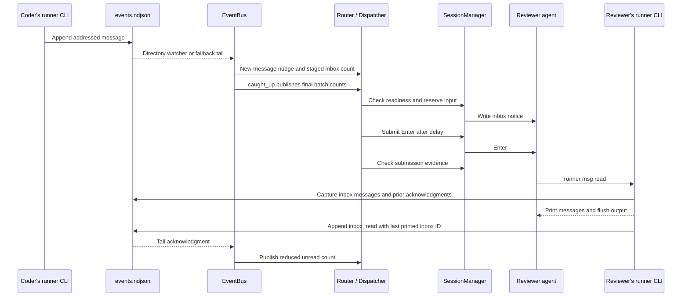

# Mission message delivery: from the log to an agent's inbox

Updated for #1046 on 2026-10-30. This note follows the implemented delivery path for mission members: message storage, inbox projection, terminal notification, reading and recovery. The broader [sessions and routing walkthrough](./sessions-and-routing.md) explains daemon and session ownership; [architecture §8.5](../arch/arch.md#85-delivery-model) defines the delivery model. [#1046](https://github.com/yicheng47/runner/issues/1046) adds idle-only notices, a ten-minute cap on screen-observed draft holds and cleanup of orphaned input-method compositions.

## 1. What delivery means

Runner stores a message in the mission's `events.ndjson`. It then types a short notice into each recipient's terminal:

```text
[inbox] 3 new messages — run `runner msg read` to view.
```

The notice contains a count and an instruction, not the message bodies. The agent retrieves the bodies by running `runner msg read`. That command also acknowledges the inbox messages it successfully prints. These are three separate milestones:

| Milestone | What Runner knows | What it does not establish |
| --- | --- | --- |
| Message appended | The mission log contains the message. | A recipient has seen it. |
| Notice submission confirmed | Terminal/runtime evidence indicates the typed notice was submitted. | The agent has read the inbox. |
| Inbox read acknowledged | An unfiltered read printed and flushed a captured batch, then appended an acknowledgment. | The agent understood or completed the requested work. |

Messages and read acknowledgments survive session stops and daemon restarts in the log. Notification attempts are temporary bookkeeping reconstructed from the remaining unread backlog. Duplicate notices are possible; exactly-once execution of the work is outside this protocol.

Typing into the composer is the only channel today. Native channels that avoid the composer (`PostToolUse` and `Stop` hooks while working, Claude Code's `asyncRewake` and a Codex app-server connection while idle) are not built; #1046's deleted spec records that direction at a [fixed revision](https://github.com/yicheng47/runner/blob/a23d578f1b6a07312df580f658de3a46f3f14248/docs/features/1046-hook-inbox-delivery.md#later-native-channels).

## 2. One message end to end

Suppose `coder` and `reviewer` are members of the same mission:

```sh
runner msg post --to reviewer "Review the parser change in this branch."
```



The app window is not a transport hop in this sequence. `runnerd` owns the bus, router and sessions. App-facing events update the UI, but a disconnected desktop client does not stop mission delivery.

## 3. Posting and storing messages

Inside a mission, [`runner-cli/src/msg.rs`](../../crates/runner-cli/src/msg.rs) loads the mission roster, resolves recipients and appends directly to the log. The daemon's external posting path lives in [`ops/mission.rs`](../../crates/runner-daemon/src/ops/mission.rs). Both use the shared [recipient resolver](../../crates/runner-core/src/addressing.rs).

- Repeated `--to` arguments address several members. Explicit recipients take precedence over mentions in the text.
- Without `--to`, consecutive leading `@handle` mentions address the message. A mention later in a sentence does not address it.
- No recipients means broadcast. A member never receives its own message in its inbox, including its own broadcast.
- Recipient handles are checked against the mission roster. `human` is not a member inbox recipient; members reach the person through broadcasts or human-question cards.

[`EventLog::append`](../../crates/runner-core/src/event_log/log.rs) takes a cross-process exclusive file lock, repairs an incomplete trailing record, raises its ULID generator above the last valid on-disk ID and writes one newline-terminated event. Cooperating producers therefore share file order and increasing IDs. A failed write attempts to truncate back to the previous length.

The log is the restart recovery record. Appending does not call `sync_all` or `sync_data`, so this is not a per-message guarantee against power loss. SQLite, roster files and the event log are separate stores rather than one transaction.

## 4. Turning the log into inboxes

The per-mission [`EventBus`](../../crates/runner-daemon/src/event_bus/mod.rs) watches the mission directory and tails the log from a byte offset. A filesystem notification is a prompt to check the file, not the event itself. A 500 ms receive timeout also triggers a tail, so a missed watcher notification does not permanently strand a message. Malformed complete lines are skipped with diagnostics; an incomplete trailing line waits for completion or append-time repair.

For a handle `h`, the inbox contains message events from another sender whose recipients are empty or include `h`. Signals are excluded. `RoleInbox` tracks matching IDs and offsets, a read index, a read watermark and the membership start offset. Original members start at the beginning; later members start after their `role_joined` boundary. Membership changes are folded in log order.

Three event surfaces have different jobs:

| Surface | Responsibility |
| --- | --- |
| `EventLog` | File-backed history shared by daemon and in-mission CLI producers/readers. |
| `EventBus` | Rebuildable inbox/read-cursor projection and direct callbacks to the router. |
| `EventChannel` | Client-facing UI updates over IPC; not the authoritative message history. |

### Publishing a complete batch

[`RouterSubscriber`](../../crates/runner-daemon/src/router/mod.rs) receives every appended event plus inbox and watermark updates. Inbox counts are staged in `projecting_unread`; only the bus's `caught_up` callback publishes the completed batch to the dispatcher. A message and its acknowledgment in the same replay batch therefore produce the final unread count before a notice is considered.

Counts are not the only trigger. For each new live message, [`message_nudge`](../../crates/runner-daemon/src/router/handlers.rs) marks its recipients in `changed_backlogs`. The batch callback dispatches those handles even if the final unread count equals its previous value. Reading message A and receiving message B in one batch can leave the count unchanged without losing B's notification trigger.

The router currently retains published unread counts rather than a notified-through message watermark. The bus's `last_id` and read watermark serve the inbox/read-cursor projection; there is no implemented hook-delivery cursor.

## 5. Deciding whether a terminal can receive a notice

[`Router`](../../crates/runner-daemon/src/router/mod.rs) owns handle-to-session mappings, published backlogs, pending human questions and its replay cursor. [`Dispatcher`](../../crates/runner-daemon/src/router/dispatch.rs) owns each subscriber's attempt, retry deadlines, leftover notice and blocked state. One driver thread per mission receives backlog/session events and waits until the next deadline. It copies router state before calling the session manager, without holding the router mutex across those calls.

The dispatcher uses the `StdinInjector` port implemented by `SessionManager`. Readiness is checked once before an attempt and again while reserving the session's input gate:

| Readiness | Meaning |
| --- | --- |
| `Pending` | Session registered, spawn not completed. |
| `Unavailable` | No live session handle; keep the backlog for resume. |
| `Starting` | Startup delivery hold has not cleared. |
| `NeedsYou` | A surfaced interaction, such as an approval, needs a human response. |
| `InFlight` | Another reserved delivery or queued local-input ticket owns the input path. |
| `Drafting` | Composer observations or pending local input require preserving a draft. |
| `Unsent` | The composer's tracked input still contains Runner's own unsubmitted notice. |
| `RecentlyTyping` | Recent local input requires a timed hold. |
| `Ready { idle }` | An attempt may start only with `idle: true`, including for a new message. |

[`StartupDelivery`](../../crates/runner-daemon/src/session/manager/startup.rs) uses suitable hook ready/idle evidence, with an outcome required when an initial turn is pending. Output-only fallback requires output to have begun, a ten-second startup grace and the normal quiet interval. A short pause during initialization is insufficient.

Draft holds come from [`SessionModel::draft_hold`](../../crates/runner-daemon/src/session/state/mod.rs), using native input observations when available, otherwise terminal observations and local-input tracking. [`InputTracker`](../../crates/runner-terminal/src/input_state.rs) interprets the runtime's composer. Recent local input holds delivery for up to two seconds. A screen-observed `Drafting` holds only while `last_local_input_at` is less than ten minutes old; no keystroke since attach means no draft hold. Every input-method composition update refreshes that time, even if its reported state stays unchanged. Pi’s native `EditorDraft` remains uncapped, as does Runner’s own `Unsent` notice. An unknown composer with no pending local input or recent typing does not itself create a hold; draft protection depends on the evidence these paths can observe.

Every new attempt requires `Ready { idle: true }`, checked by the dispatcher and again at reservation. A message posted during a turn stays queued; the existing Idle transition requests delivery when the turn ends.

## 6. Typing, submitting and confirming

The human and router share the PTY input path. A reservation prevents queued local input from interleaving between the notice text and its delayed Enter. The generation token prevents an old attempt from writing into a replacement process. Local input uses tickets; waiting happens in daemon input workers rather than on the app's render thread.

An attempt proceeds as follows:

1. Reserve the delivery gate and reread the published unread count. If it is now zero, release the reservation without typing.
2. Capture the terminal input rows, delivery generation, input revision and turn-start counter. Write the notice using `inject_reserved`.
3. After the platform submit delay, locate the notice in the changed input rows and send Enter through the same reservation. Release the gate immediately after this submission stage.
4. At the confirmation deadline, compare the current snapshot with the captured one. The dispatcher continues servicing other members while this window runs.

The timing constants are defined in [`router/mod.rs`](../../crates/runner-daemon/src/router/mod.rs) and [`router/dispatch.rs`](../../crates/runner-daemon/src/router/dispatch.rs):

| Timer | Current value | Purpose |
| --- | --- | --- |
| `SUBMIT_DELAY` | 80 ms on Unix; 300 ms on Windows | Separate notice text from Enter, including Windows Codex paste-burst suppression. |
| `CONFIRM_WINDOW` | 1.5 s | Wait for evidence that the notice was submitted. |
| `INPUT_CLEAR_GRACE` | 500 ms | Recheck readiness after input-clear or readiness-change events. |
| `REDELIVERY_INTERVAL` | 30 s | Reconcile unread backlogs. |
| `REDELIVERY_BACKOFF` | 120 s | Space periodic retries of an unacknowledged backlog. |

### Submission outcomes

[`InputProbe`](../../crates/runner-terminal/src/delivery_probe.rs) captures rows changed by typing before Enter. It tracks those rows, not the terminal cursor or a later transcript echo. [`delivery_snapshot` and `resubmit`](../../crates/runner-daemon/src/session/manager/bookkeeping.rs) combine this probe with session/input guards.

| Outcome | Evidence and behavior |
| --- | --- |
| `Confirmed` | Generation and input revision are unchanged, and a new runtime turn started or the captured notice cleared without still being tracked as unsent. The manager can publish a synthetic busy transition. |
| `Unsubmitted` | Positive evidence still places the notice in input. One immediate second Enter is permitted under unchanged generation/input and human-interaction guards. If it still remains, preserve the leftover and pause new typing. |
| `Unverified` | Evidence is ambiguous, unavailable, or local input/generation changed. This does not justify an immediate extra Enter. Preserve the unread backlog and any possible leftover for later reconciliation. |

The confirmation window is evidence collection after submission, not an added delay before the agent can see the notice. Even `Confirmed` does not acknowledge any messages.

### A notice left in the composer

A positively seen leftover prevents a second notice from being typed on top of it. Later eligible Idle/readiness events or reconciliation after backoff can try submitting that same notice again, provided the unchanged-input checks pass. These retries send Enter, not another copy of the text. Ownership follows the composer text matching its recorded `submitted_form`, so moving the cursor keeps the notice labelled **Message not submitted — press Return**. Any person input changes the revision and prevents automatic Return; a key that changes the text turns it into the person’s draft. Submit / clear retains its revision guard. The pause on a positively seen leftover takes priority over the draft cap.

A resize or redraw can make the original probe unknown. The dispatcher can release a previously seen leftover on input-clear evidence only when readiness is also `Ready`; a probe that still positively sees the text retains the pause. `ReadinessChanged` is not itself proof that input cleared. The special `SilenceIdle` handling prevents the redraw after an ignored Enter from creating a rapid retry loop.

## 7. Reading is the acknowledgment

[`runner msg read`](../../crates/runner-cli/src/msg.rs) captures a finite batch, prints it and flushes stdout, then appends an `inbox_read` signal with `up_to` set to the last printed message belonging to that reader's inbox. A later arrival is not covered, even if it arrives before the acknowledgment is appended.

| Read mode | Output | Acknowledgment |
| --- | --- | --- |
| `runner msg read` | Unread inbox messages plus a short digest of other crew traffic. | Through the last printed inbox message. |
| `runner msg read --all` | Crew message history since the member joined. | Through the last printed message belonging to that member's inbox. |
| A read with `--since` or `--from` | The selected inspection subset. | None, including when combined with `--all`. |

Digest entries never advance the read watermark. Filtered reads warn when unread inbox messages remain. An output or flush failure prevents the acknowledgment. An acknowledgment append failure is reported to stderr and leaves messages unread; in this revision that warning does not make the read return a failure exit code.

The bus validates that `up_to` names a message in the sender's inbox and advances the cumulative watermark only forward. Duplicate, stale or invalid acknowledgments do not consume newer messages.

An optional `MissionReadCursor` from the already-running daemon lets the CLI start from its membership/acknowledged offset instead of rereading the whole log. Its acknowledgment offset is immediately after the acknowledged message, not after the later acknowledgment signal. The CLI folds valid newer acknowledgments in the captured batch; an unavailable cursor falls back to reading/folding the log. The cursor query does not start a daemon.

Keep these positions distinct: the bus tail offset tracks projected bytes; the router replay cursor suppresses historical signal-handler effects; the member's read watermark tracks consumed inbox messages. Notification attempts advance none of the read watermarks.

## 8. Retry, human interaction and recovery

Backlog changes request delivery without waiting for the periodic reconciliation tick, but every new attempt waits for idle. Screen-observed drafts expire ten minutes after the last local keystroke, with the next reconciliation or eligible session event retrying delivery; a real abandoned draft can then receive the notice and be submitted with it. Pi’s native drafts and Runner’s own leftover notices never expire through this cap. Periodic redelivery reconciles every 30 seconds and on Idle, requires an idle recipient and observes the two-minute backoff since its last attempt. Readiness changes and respawn have their own retry paths; the backoff is not a universal delay on new messages. An acknowledgment that clears the backlog cancels a notice still waiting behind a readiness hold.

`router/delivery-blocked` reports the unread count and a reason for `draft`, `needs_you` or `unsubmitted`. Draft and approval holds show **Inbox waiting**; an unsubmitted notice asks the person to press Return. Other gates can hold delivery without this UI state. The daemon logs hold changes and warns once when a qualifying hold outlasts the backoff. Unavailable sessions have a separate queued-until-resume warning, with initial reconstruction avoiding repeated warnings for already-stopped sessions.

The daemon associates each desktop composition with the client connection that started it. Connection close or terminal-control handover clears the orphaned flag and emits `InputCleared`; it never commits the composition text. A late clear from a previous connection cannot clear another client’s composition. The app retries failed `Composing { composing: false }` requests while it retains control, cancelling the retry when a new composition starts.

Human traffic joins the same inbox path through [`router/handlers.rs`](../../crates/runner-daemon/src/router/handlers.rs):

- `human_said` becomes an ordinary message from `human` with its resolved recipients; untargeted text broadcasts.
- `ask_human` creates a `human_question` card. The router records the original asker against the card ID.
- `human_response` becomes a message to that recorded asker, with the question excerpt, `question_id` and `source_event`. The card's `on_behalf_of` context does not change the return address.

Fresh start and reopen share [`mount_mission_router`](../../crates/runner-daemon/src/ops/mission.rs). Reopen restores the session mapping and pending questions, and sets the router's replay cursor before mounting the bus. The bus still replays the log to reconstruct inboxes and acknowledgments. Already-read history stays quiet; unread history remains eligible for notification after session readiness permits it.

There is a targeted crash repair for person signals marked `delivery: "inbox"`: if no derived message with the matching `source_event` exists, reconstruction appends the missing message. Legacy unmarked signals do not replay their side effects. This is not a transaction covering every router handler.

| Boundary | Retained | Recreated or retried |
| --- | --- | --- |
| Desktop disconnect/reconnect | Daemon-owned sessions, bus, router and attempts. | Client snapshots and subscriptions. |
| Session exit/respawn | Log, membership and read watermark. | Live process, startup hold and delivery-attempt state. |
| Daemon restart | Persisted mission/session data, event log and read acknowledgments. | Bus projections, router state and dispatch deadlines; session processes follow the normal resume lifecycle. |
| Failed notification | Message bodies and unread state. | Guarded submission or later notification. |

## 9. Reading the code and diagnosing a delay

Follow the path in this order:

| Source | What to inspect |
| --- | --- |
| [`runner-cli/src/msg.rs`](../../crates/runner-cli/src/msg.rs), [`addressing.rs`](../../crates/runner-core/src/addressing.rs) | Producer identity, recipients, captured read batch, output-before-ack ordering. |
| [`event_log/log.rs`](../../crates/runner-core/src/event_log/log.rs) | Append locking, monotonic IDs and tail repair. |
| [`event_bus/mod.rs`](../../crates/runner-daemon/src/event_bus/mod.rs) | Membership, matching messages, acknowledgment validation and batch boundary. |
| [`router/mod.rs`](../../crates/runner-daemon/src/router/mod.rs), [`handlers.rs`](../../crates/runner-daemon/src/router/handlers.rs) | Replay suppression, new-message nudges, backlog publication and human-question routing. |
| [`router/dispatch.rs`](../../crates/runner-daemon/src/router/dispatch.rs) | Attempt deadlines, outcomes, leftover recovery and redelivery eligibility. |
| [`session/manager/mod.rs`](../../crates/runner-daemon/src/session/manager/mod.rs), [`bookkeeping.rs`](../../crates/runner-daemon/src/session/manager/bookkeeping.rs), [`output.rs`](../../crates/runner-daemon/src/session/manager/output.rs) | Readiness, reservations, snapshots, local-input tickets and guarded PTY writes. |
| [`session/state/mod.rs`](../../crates/runner-daemon/src/session/state/mod.rs), [`input_state.rs`](../../crates/runner-terminal/src/input_state.rs), [`delivery_probe.rs`](../../crates/runner-terminal/src/delivery_probe.rs) | Draft evidence, injected-input tracking and submission confirmation. |
| [`router/tests/mod.rs`](../../crates/runner-daemon/src/router/tests/mod.rs) | Manual-clock examples of readiness holds, confirmation, retry, replay and human replies. |

For a delayed message, first check that the log contains a message addressing the intended member and whether a valid `inbox_read` already covers it. Then follow the published backlog and readiness hold. Daemon lines containing `router delivery held`, `router attempt outcome=` and `router resubmitted unsent notice` distinguish a draft/approval hold, an attempted submission and recovery of a leftover. A repeated notice with no new message can be expected redelivery of an unread backlog; a confirmed notice with no read acknowledgment means attention was attempted but the inbox remains unconsumed.
